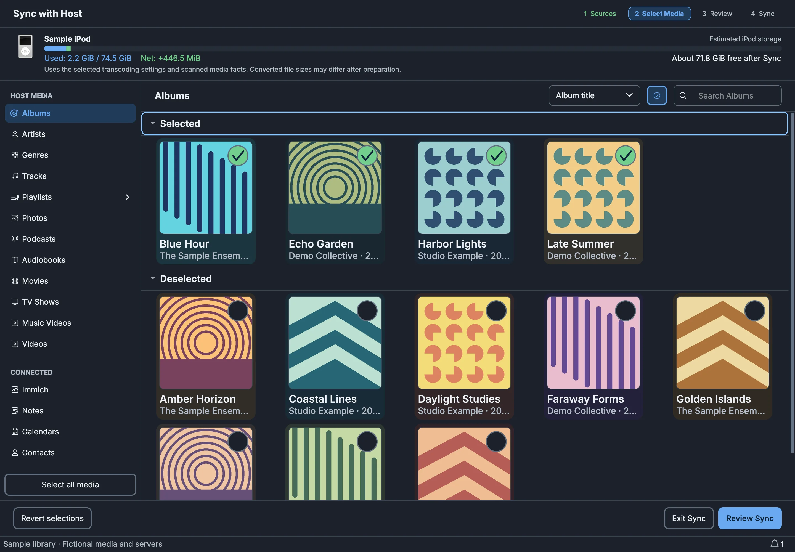
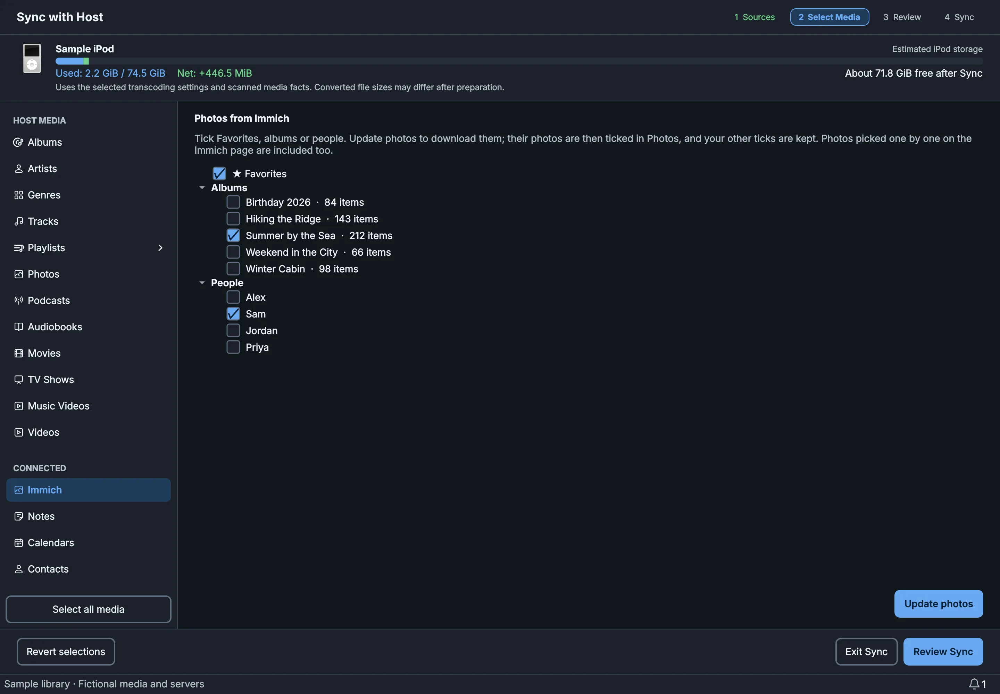
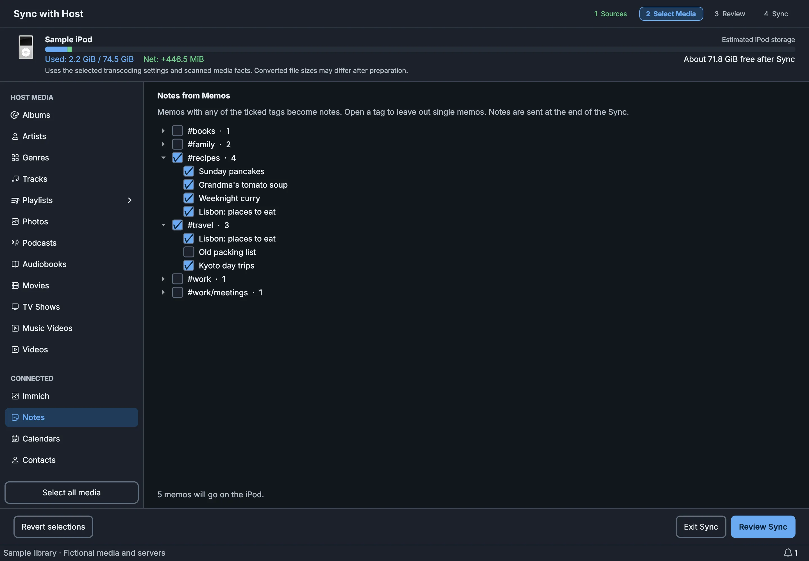
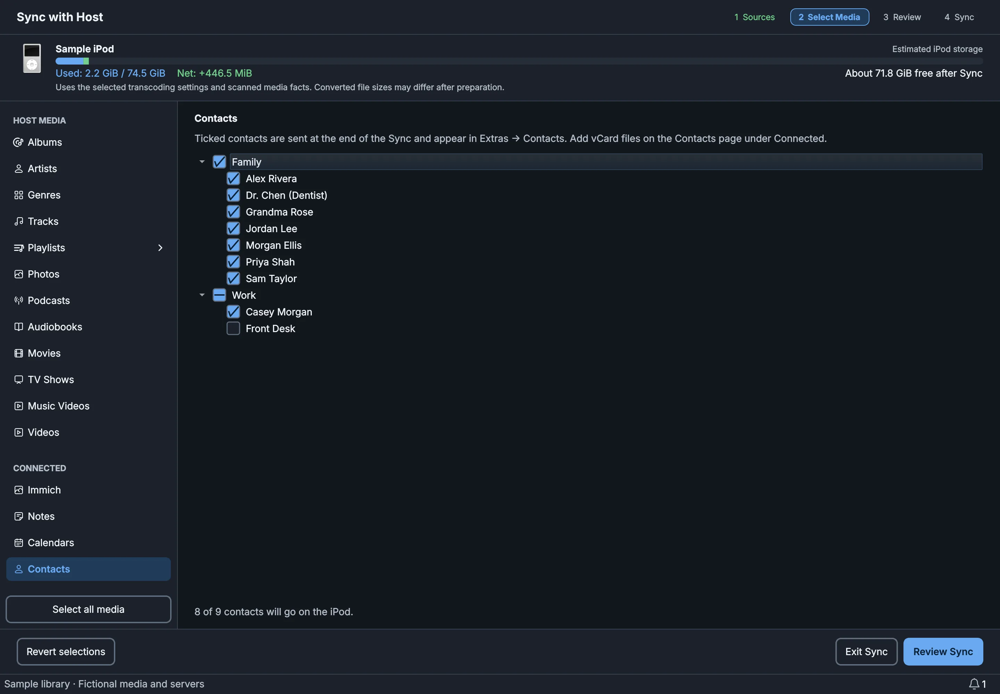
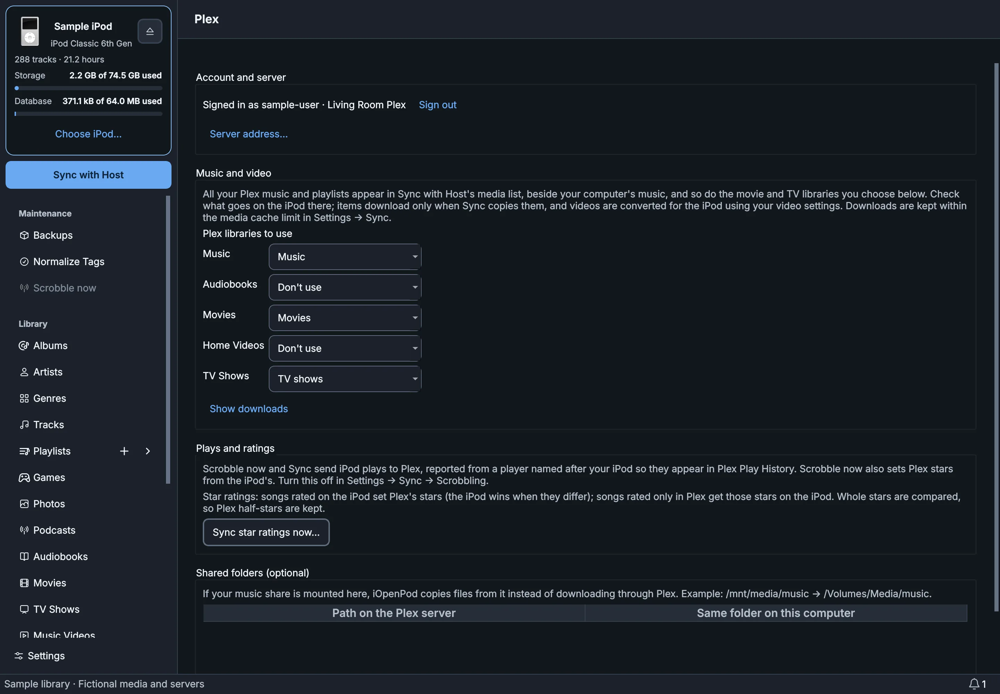
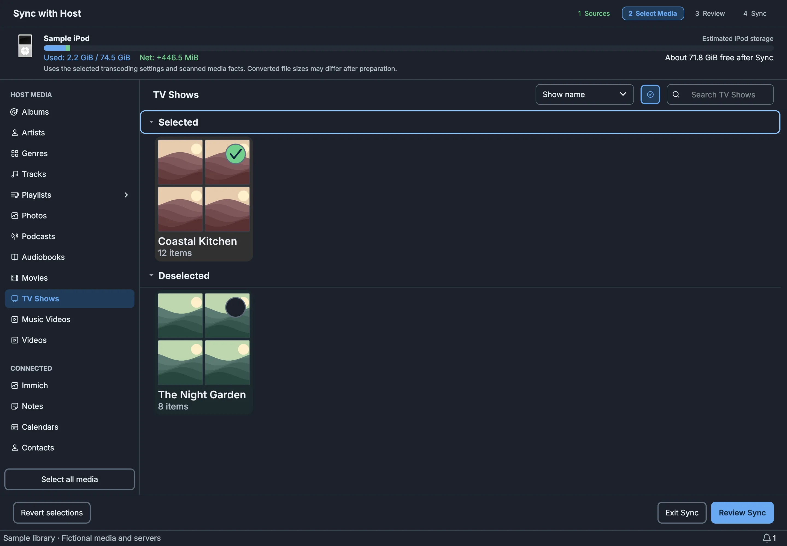
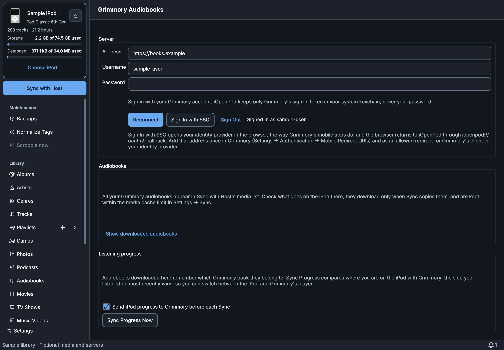
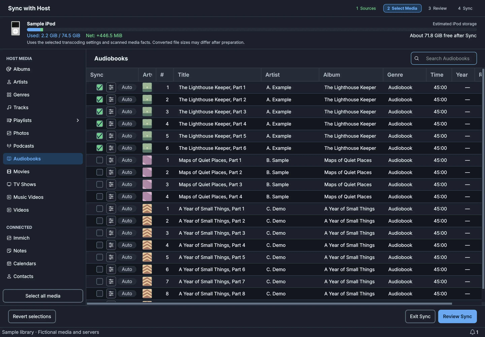
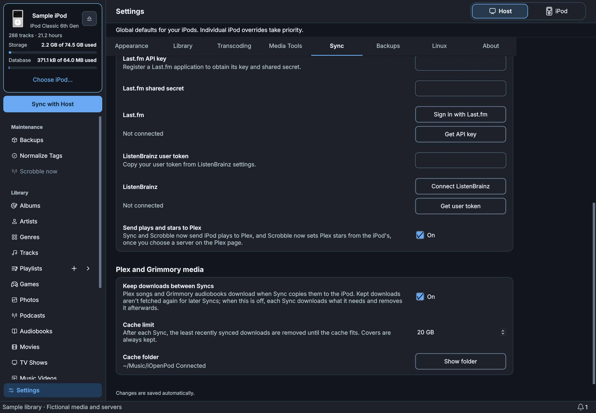

# iOpenPod, Connected Sources edition

**Your servers. Your iPod. One Sync.**

[](LICENSE)
[](#install)
[](https://github.com/9retirement6irk/iOpenPod/releases/latest)
[](https://github.com/TheRealSavi/iOpenPod)

This is a fork of [iOpenPod](https://github.com/TheRealSavi/iOpenPod), the free,
open-source iPod manager for **Windows, macOS and Linux**. It keeps everything
iOpenPod does and adds **Connected Sources**: your Plex music and video, Grimmory
audiobooks, Immich photos, Memos notes, calendars and contacts all go onto your iPod
in one **Sync with Host**, with nothing exported by hand.



* [What this fork adds](#what-this-fork-adds)
* [One Sync for everything](#one-sync-for-everything)
* [Plex: music, playlists, movies and TV](#plex-music-playlists-movies-and-tv)
* [Grimmory: audiobooks and listening progress](#grimmory-audiobooks-and-listening-progress)
* [Immich: photos](#immich-photos)
* [Notes, calendars and contacts](#notes-calendars-and-contacts)
* [Downloads and the media cache](#downloads-and-the-media-cache)
* [Privacy and safety](#privacy-and-safety)
* [Install](#install)
* [Everything else iOpenPod does](#everything-else-iopenpod-does)
* [Develop](#develop)
* [License and credits](#license-and-credits)

## What this fork adds

| Source | What reaches your iPod | Set up on |
| ------ | ---------------------- | --------- |
| [Plex](https://www.plex.tv/) | Music, playlists, movies, TV shows and music videos; plays and star ratings go back to Plex | Connected → Plex |
| [Grimmory](https://github.com/grimmory-tools/grimmory) | Audiobooks, with listening progress kept in step both ways | Connected → Grimmory |
| [Immich](https://immich.app/) | Photos from Favorites, albums, people or single photos | Connected → Immich |
| [Memos](https://usememos.com/) | Notes from the tags you choose, in Extras → Notes | Connected → Notes |
| Calendars | `.ics` files and subscription links, in Extras → Calendars | Connected → Calendars |
| Contacts | vCard (`.vcf`) files, in Extras → Contacts | Connected → Contacts |

Each source is optional. Set up the ones you use; the rest stay out of the way.

## One Sync for everything

Set each source up once on its page under **Connected** in the sidebar. From then
on, **Sync with Host** is the only button you need: it lists your Plex and
Grimmory media beside your computer's music, and its **CONNECTED** section chooses
photos, notes, calendars and contacts. Everything goes through the usual Sync
Review, so nothing changes on the iPod until you say so.

* **Music, video and audiobooks** from Plex and Grimmory appear on Sync's Albums,
  Tracks, Movies, TV Shows, Music Videos and Audiobooks pages. Tick what you want;
  each item downloads only when Sync copies it.
* **Playlists:** tick a Playlist in the sidebar to put it and all its songs on the
  iPod. Playlists you've synced before stay ticked; unticking one never removes
  songs already on the iPod.
* **Photos:** tick Immich Favorites, albums or people. **Update photos** downloads
  them and rescans, keeping every other tick you've made, and their photos are
  ticked for you.
* **Notes:** tick Memos tags, and open a tag to leave out single memos.
* **Calendars and contacts:** tick each calendar, or each contact file or person.

Notes, calendars and contacts are written to the iPod at the end of the Sync,
replacing only what iOpenPod put there before. Notes you wrote yourself stay put.

| Photos from Immich | Notes from Memos |
| ------------------ | ---------------- |
|  |  |



## Plex: music, playlists, movies and TV

Sign in with your Plex account and choose a server. Then, for each Plex library,
choose what it's for:

* **Music libraries:** *Music* or *Don't use*. Leave out an audiobook library if
  Grimmory provides your audiobooks.
* **Movie libraries:** *Movies*, *Music videos* or *Don't use*.
* **TV libraries:** *TV shows* or *Don't use*.

**Music videos from Plex's music video folders.** Plex can also keep music
videos with your artists and songs instead of in a library: beside the music, or
in the server's **Global music videos path** (Plex **Settings → Extras**). Tick
**Include music videos from Plex's music video folders** on the Plex page and
they're listed on Sync's Music Videos page too, for the music libraries in use.
Music, lyric and live music videos come along; interviews, concerts and other
extras don't.

Music libraries start in use; video libraries start unused because videos are
large. Songs keep their album's genre and year, and Plex playlists come along with
the songs you've chosen. TV episodes keep their show, season and episode number,
and movies and music videos get their posters. Videos are converted for the iPod
with your existing video settings, so long films take a while. They only appear
for iPods that play video.

**Plays and stars go back to Plex.** **Scrobble now** and every Sync send the
iPod's plays to Plex, where they show up in Play History as your iPod. Scrobble
now also gives Plex songs the iPod's star ratings. Turn this off in **Settings →
Sync → Scrobbling**. To bring Plex-only stars onto the iPod, use **Sync star
ratings now…** on the Plex page, which shows the changes for you to review first.

If your music share is mounted on your computer, add it under **Shared folders**
and iOpenPod copies files from it instead of downloading them through Plex.

| Plex page | TV shows in Sync |
| --------- | ---------------- |
|  |  |

## Grimmory: audiobooks and listening progress

Sign in with your Grimmory username and password, or with **Sign In with SSO**,
the way Grimmory's mobile apps do. For single sign-on, add
`iopenpod://oauth2-callback` once in Grimmory (**Settings → Authentication →
Mobile Redirect URIs**) and as an allowed redirect in your identity provider.

All your Grimmory audiobooks then appear on Sync's Audiobooks page, downloaded
only when Sync copies them. Downloaded books remember which Grimmory book they
came from, and **listening progress stays in step**: before each Sync, where you
stopped on the iPod goes to Grimmory. **Sync Progress Now** also works the other
way, so where you stopped in Grimmory becomes the iPod's bookmark. Whichever side
you listened on most recently wins.

Tested with Grimmory 3.5.

| Grimmory page | Audiobooks in Sync |
| ------------- | ------------------ |
|  |  |

## Immich: photos

Connect with your server address and an API key (Immich → **Account Settings → API
Keys**, with `album.read`, `asset.read`, `asset.view`, `person.read`, and
`asset.download` for full-size photos). Choose Favorites, albums and people in
Sync, or open one on the Immich page and tick single photos, with previews.

Photos are saved as JPEG at iPod size, or full size if you prefer. Videos are
skipped.

## Notes, calendars and contacts

These go into the iPod's **Extras** menu.

* **Notes from Memos** (Memos 26.10 and earlier). Connect with an access token
  (Memos → **Settings → My Account → Access Tokens**) and pick tags; `#work`
  includes nested tags like `#work/meetings`. Each memo becomes a note titled by
  its first line, right at the top of Notes. Long memos are split into parts,
  because the iPod shows 4 KB per note and up to 1,000 notes.
* **Calendars.** Add `.ics` files, or subscription links (`https://` or
  `webcal://`, such as Google Calendar's secret iCal address), which are
  downloaded fresh at each Sync. You can leave out events that ended long ago.
* **Contacts.** Add `.vcf` files exported from your phone, Google Contacts, iCloud
  or Outlook. Each contact becomes its own card the iPod can read (up to 5,000),
  so one bad card can't hide the rest. Photos inside contacts are left out
  because the iPod can't show them.

## Downloads and the media cache

Plex and Grimmory downloads are kept in `~/Music/iOpenPod Connected`, up to a size
limit you choose in **Settings → Sync** (20 GB to start). When the cache is full,
the downloads synced least recently are removed first. Turn **Keep downloads
between Syncs** off and each Sync removes its downloads when it finishes.

Syncing from more than one computer works: a Plex song or Grimmory book already on
the iPod is recognized on any computer, even one that hasn't downloaded it, so it
shows as ticked and isn't copied again.

Songs already on your iPod from before, for example FLAC files you added by
hand, are recognized as the same Plex songs when their title, artist, album,
track number and length agree, so they show as ticked and aren't copied again.
When a match isn't certain (two similar songs), the song is left alone.



## Privacy and safety

* Sign-ins, API keys, access tokens and calendar links are kept in your system
  keychain (Windows Credential Manager, macOS Keychain or the Secret Service on
  Linux), never in iOpenPod's settings files.
* iOpenPod talks only to the servers you set up. Nothing goes anywhere else.
* Sync Review shows every change before it happens, and Extras are written with
  the same verified, recoverable writes as the rest of iOpenPod.

## Install

Download the latest build for your system from
[this fork's releases](https://github.com/9retirement6irk/iOpenPod/releases/latest):

| Platform | Download | Installation |
| -------- | -------- | ------------ |
| Windows x64 | Windows x86\_64 ZIP | Extract `iOpenPod.exe` and run it. |
| macOS, Apple Silicon | macOS arm64 DMG | Open the image and drag `iOpenPod.app` to Applications. |
| macOS, Intel | macOS x86\_64 DMG | Open the image and drag `iOpenPod.app` to Applications. |
| Linux x64 | Linux x86\_64 tar.gz | Extract the whole folder and run its top-level `iOpenPod` launcher. |

The macOS builds aren't notarized; approve the first launch in **System Settings →
Privacy & Security** (see upstream's
[Mac setup guide](https://iopenpod.com/install-help/#native-macos)). On Linux the
build needs glibc 2.39 or later.

**Media tools.** FFmpeg and FFprobe are needed for converting media, and
Chromaprint's `fpcalc` is optional for acoustic matching. **Settings → Media
Tools → Set Up Media Tools** can install them for you.

**Versions.** A release such as **v2.1.3-1** contains upstream iOpenPod 2.1.3
plus this fork's revision 1.

**Updates.** Builds of this fork check *this fork's* releases, never upstream's,
so an update can never replace them with a version without Connected Sources.
When a newer release is out, **Settings → About → Check for updates** links to its
download page. This fork isn't on the Microsoft Store or PyPI; those are
upstream's.

## Everything else iOpenPod does

Everything from upstream iOpenPod is here, and the fork keeps up with its
releases:

* Browse albums, artists, genres and tracks; edit metadata, artwork and ratings.
* Playlists, playlist folders and Smart Playlists.
* Automatic audio and video conversion for your iPod model.
* Photos, podcasts, Backup Snapshots, playback and Synesthesia visuals.
* Click wheel games without a virtual machine, and Phase Playlists from your music.
* Scrobbling to Last.fm and ListenBrainz, alongside Plex.

It works with **iPod classic, iPod mini, iPod nano and earlier full-size iPods**
that your computer can read and write. iPod shuffle, iPod touch and iPhone aren't
supported. See the [upstream README](https://github.com/TheRealSavi/iOpenPod#readme)
and [iopenpod.com](https://iopenpod.com) for guides on these features.

## Develop

Clone the repository and use the locked UV environment:

```shell
uv sync --locked
uv run python scripts/prepare_qt_typing.py
uv run iopenpod
```

Before pushing, run the checks:

```shell
uv lock --check
uv run ruff format --check .
uv run ruff check .
uv run rumdl check .
uv run mypy
uv run pytest
```

Start with [AGENTS.md](AGENTS.md), [CONTEXT.md](CONTEXT.md) and
[GLOSSARY.md](GLOSSARY.md). The fork's design is recorded in
[ADR-0900](docs/adr/0900-add-connected-sources-and-ipod-extras.md); fork decision
records are numbered from 0900 so upstream merges never collide.

The screenshots above are the real app rendered with fictional sample data and
servers. Recreate them with:

```shell
uv run python -m scripts.capture_fork_screenshots
```

**Releasing.** Releases are named after the upstream iOpenPod version they're
built on, plus this fork's revision: **v2.1.3-1** is upstream 2.1.3 with this
fork's first release on top, **v2.1.3-2** the next, and after merging upstream
2.1.4 the count starts again at **v2.1.4-1**. In `pyproject.toml` (and
`uv.lock`) that's written the Python way, `version = "2.1.3.post1"`. Raise it,
push to `main`, then run **Actions → Build and release** on `main` with
**Publish** ticked. The workflow creates the `v2.1.3-1` tag and the release
itself. Windows and macOS builds carry it as `2.1.3.1`.

## License and credits

Licensed under **GPL-3.0-or-later**, like upstream. See [LICENSE](LICENSE),
[COPYING.md](COPYING.md) and [ACKNOWLEDGEMENTS.md](ACKNOWLEDGEMENTS.md).

iOpenPod is created by [John Gibbons](https://github.com/TheRealSavi) and its
contributors; consider [supporting upstream development](https://ko-fi.com/johngibbons).
Thanks to [Dylan Staley](https://github.com/dstaley/hashab) for the HASHAB
WebAssembly implementation, [dotm5](https://github.com/dotm5/Genius-Mix-Research)
for Genius research, and [Olsro](https://github.com/Olsro/ipodclickwheelgamespreservationproject)
for preserving iPod click wheel games.

Plex, Grimmory, Immich and Memos are independent projects; this fork isn't
affiliated with or endorsed by them. Independent software, not affiliated with or
endorsed by Apple Inc. iPod and iTunes are trademarks of Apple Inc.
